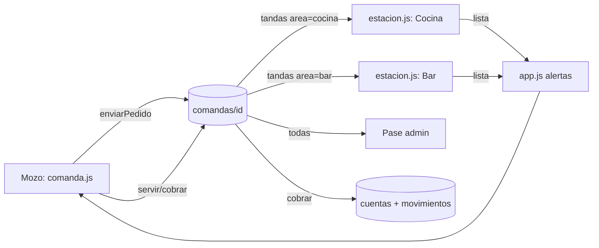

# Design Document — Rol Bar y estaciones

## Overview

La comanda sigue siendo **un solo documento** (`comandas/{id}`). `items[]` es lo que se cobra; `tandas[]` es lo enviado a preparar. La división ocurre al enviar: una tanda por área. Así el cobro no cambia y la preparación queda separada.

## Architecture



## Components

| Módulo | Responsabilidad |
|---|---|
| `estaciones.js` (nuevo) | Estaciones configurables (`settings.estaciones`), resolución de área, compat (`tandaArea`) |
| `estacion.js` (reemplaza `cocina.js`) | `App.Views._estacion(area)` genérica, `App.Views.pase`, acciones atómicas de tanda, marcado por línea |
| `db.js` | `App.DB.update(store, id, mutator)` con `runTransaction`; fallback local sin red |
| `utils.js` | `calcTotales` (excluye anulados), sonidos `bar` y `anulado` |
| `store.js` | Roles dinámicos: id de estación = rol; admin accede a todas + `pase` |
| `comanda.js` | `enviarPedido(comandaId, soloArea?)`, keys por línea, anulación, liberar → cancelada |
| `mesas.js` | Servir por estación, claim atómico de mesa, reasignar desde `usuarios` |
| `cuenta.js` | Pago dividido, cobro atómico (anti doble cobro), venta con área/tiempos/anulados |
| `app.js` | Nav/headers dinámicos, badges por estación, alertas por estación (incluye tandas nuevas), recordatorios por umbral |
| `firestore.rules` | Permisos por rol |

## Data Models

```js
// item de comanda
{ key, productoId, nombre, cantidad, precio, notas, area, despachoDirecto, tandaId,
  anulado?, anuladoAt?, anuladoPor?, motivoAnulacion? }
// tanda
{ id, envioId, numero, area, directa?, estado, items:[{ key, productoId, nombre, cantidad, notas, listo?, anulado? }],
  enviadaAt, preparandoAt?, listaAt?, servidoAt?, anuladaAt? }
// estación (settings.estaciones)
{ id: 'bar', nombre: 'Bar', icono: '🍹', recordatorioMin: 4 }
```

Estados de tanda: `enviada → preparando → lista → servida`, o `anulada`.
Estados de comanda: `abierta → cerrada` (cobrada) o `cancelada` (liberada con envíos).

## Key decisions
- **Tanda por área en vez de dos comandas**: el cobro, la mesa y el mozo siguen siendo uno solo.
- **Transacciones (opción A)** antes que mapa de tandas (opción B): menor impacto en lecturas. Ids/timestamps se generan fuera del mutator para que los reintentos sean deterministas.
- **Alertas**: las tandas nuevas se avisan a la estación destino; el dispositivo emisor se excluye vía `App._localTandas`.
- **Rol = id de estación**: estaciones nuevas no requieren código; las reglas tratan como estación cualquier rol que no sea admin/mozo/cajero.

## Error Handling
- Sin red: `update` aplica el mutator sobre el cache local (Firestore sincroniza luego).
- Cobro concurrente: el segundo recibe "ya fue cobrada".
- Si el total cambia durante un pago dividido, se revierte el cierre y se piden los pagos de nuevo.
- Reglas antiguas sin lectura de `usuarios`: reasignar cae a ingreso manual de nombre.

## Testing Strategy
Verificado con un arnés Node (fuera del repo) que ejecuta los scripts reales en 5 dispositivos simulados (admin, 2 mozos, cocina, bar) contra un mock de Firestore con transacciones optimistas: división de envíos, alertas por rol, concurrencia, marcado por línea, servir por estación, anulación, pago dividido, doble cobro, liberar con pedidos en curso, Pase, estaciones nuevas en vivo, compatibilidad con datos antiguos y render de todas las vistas. Las reglas de Firestore deben validarse en el emulador o la consola (Rules Playground).
